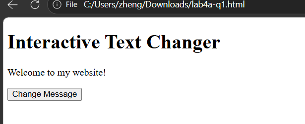
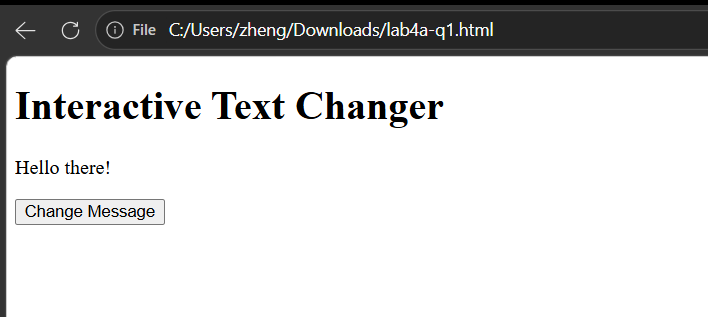
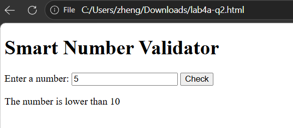
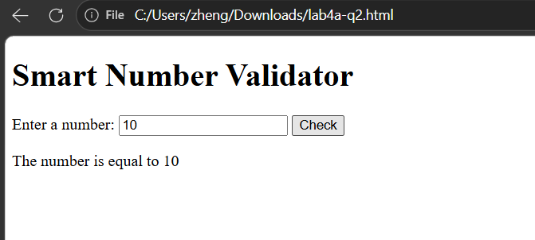
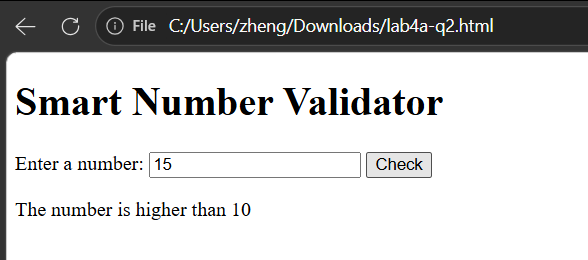
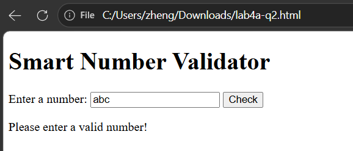
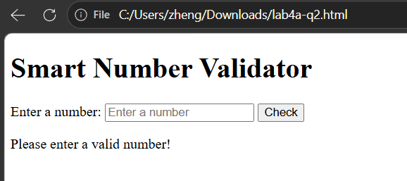
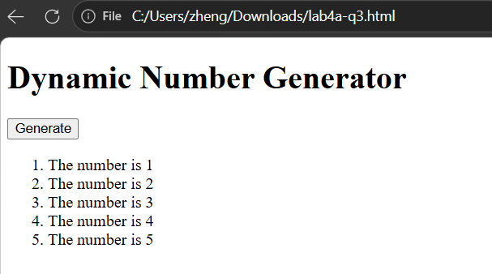

# BIC21203 Web Development - Lab 4a: Client-Side Scripting (JavaScript)

**Name:** Lim Zheng Yu
**Matric No.:** AI240112
**Session:** 2026/2027

## Overview
This repository contains three JavaScript exercises that use the DOM, event
listeners, conditions and loops. All code uses plain HTML5 and JavaScript with
no external libraries.

## Project structure
- `lab4a-q1.html` - Interactive Text Changer
- `lab4a-q2.html` - Smart Number Validator
- `lab4a-q3.html` - Dynamic Number Generator
- `screenshots/` - Output screenshots

## Question 1 - Interactive Text Changer
**Explanation:** Clicking "Change Message" runs `changeMessage()`, which changes
the paragraph text to "Hello there!" using `textContent`. The function is
attached to the button with `addEventListener("click", ...)`.

**How to run:** Open `lab4a-q1.html` in a web browser and click the button.

## Question 2 - Smart Number Validator
**Explanation:** `checkInput()` trims the input and treats empty or
whitespace-only values as invalid. It converts the text to a number and rejects
invalid values such as "abc". An `if...else if...else` structure shows whether
the number is lower than, higher than or equal to 10. Decimals such as 10.5 are
accepted as valid numbers.

**How to run:** Open `lab4a-q2.html` in a web browser, type a value and click
"Check".

**Test cases:** 5, 10, 15, abc and empty input.

## Question 3 - Dynamic Number Generator
**Explanation:** `generateNumbers()` clears the list first, then a `for` loop
from 1 to 5 creates each `<li>` with `document.createElement()`, sets its text
with `textContent` and appends it to the ordered list. Clearing first means
repeated clicks do not create duplicate items.

**How to run:** Open `lab4a-q3.html` in a web browser and click "Generate". Try
clicking it several times.

